# RandomSpawnPanel.cs

[返回总索引](../README.md) · `Runtime` · `Assets/DarwinPark/UI/RandomSpawnPanel.cs`

[源文件](../../../Assets/DarwinPark/UI/RandomSpawnPanel.cs) · 源码校验：`fd0908f08a817e61d039bee2b1eb78f62d13ef329dea23a1f1e68ec90b17cba9`

方法按源文件位置排列。事件/回调引用不表示立即执行；分支与异常说明见总索引。完整源码与可点击关系图请打开离线手册。

## LandOnly.get · L18

`public bool LandOnly`

### Editor / Player · 语法控制结构 / 声明（非CFG）

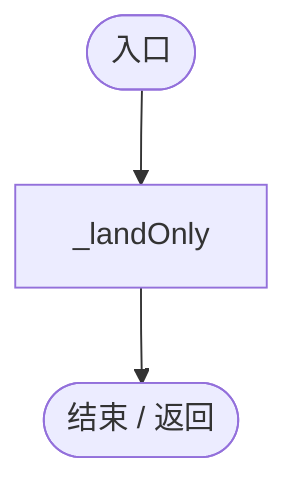

## Recipe.get · L19

`get`

### Editor / Player · 语法控制结构 / 声明（非CFG）

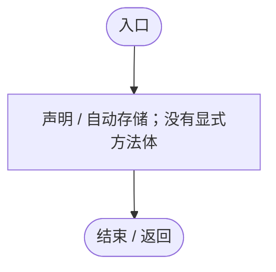

## Recipe.set · L19

`private set`

### Editor / Player · 语法控制结构 / 声明（非CFG）

## Attach · L20

`public static void Attach(Transform parent)`

### Editor / Player · Roslyn编译器控制流

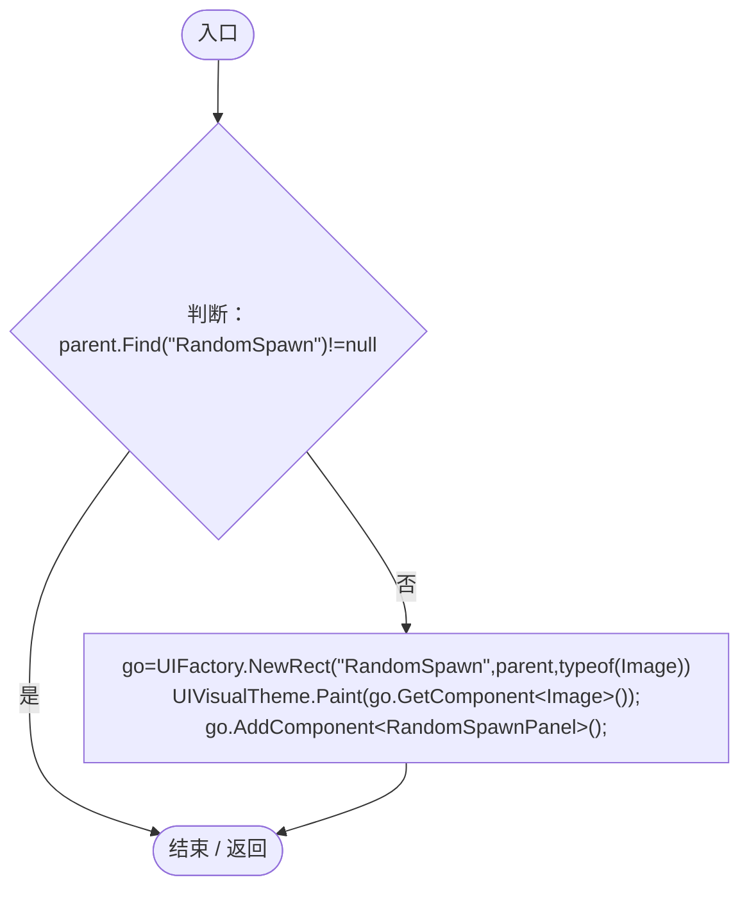

项目内调用/回调引用：

- [UIFactory.NewRect · L33](dd1096a6995423db.md#med612116f3152344)（方法）
- [UIVisualTheme.Paint · L58](ca525a798a08f966.md#m2d61a6b26ab24980)（方法）

## Start · L25

`private void Start()`

### Editor / Player · Roslyn编译器控制流

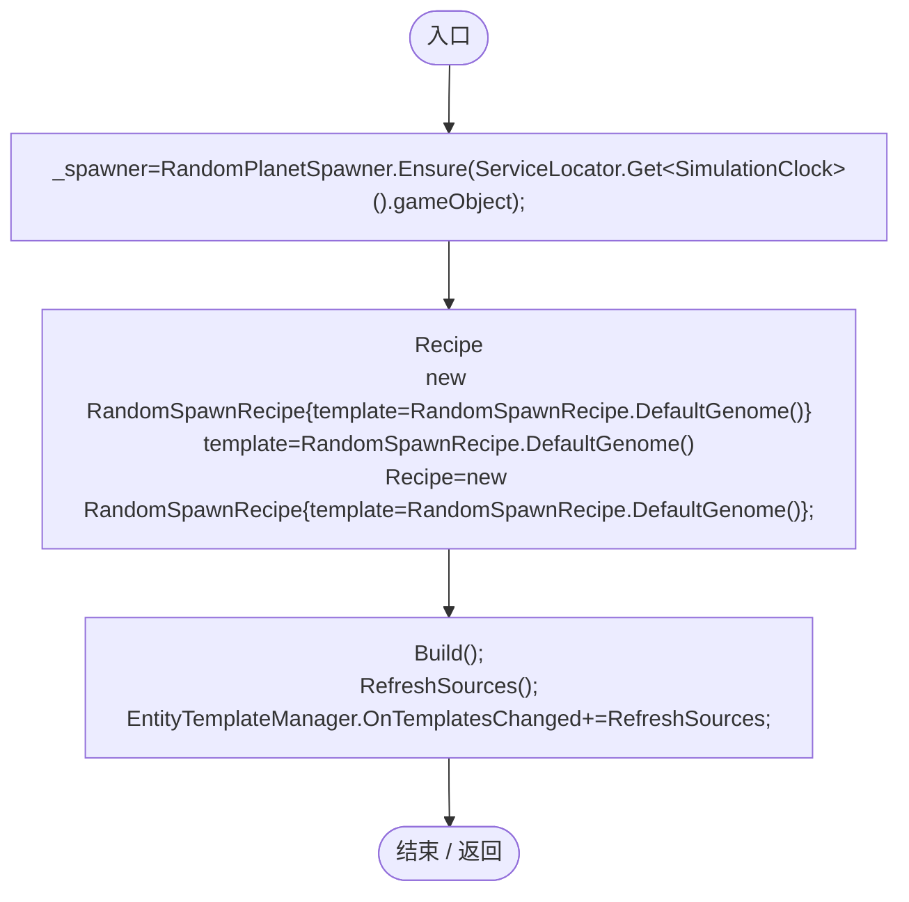

项目内调用/回调引用：

- [RandomPlanetSpawner.Ensure · L24](1c13222a547b265c.md#mccefd1367aa9ded3)（方法）
- [ServiceLocator.Get · L33](f2fdbe9f9ccd93cb.md#m2ae625299520c56d)（方法）
- [RandomSpawnPanel.Recipe.set · L19](ff6518313bce61e2.md#m0a443248b065e69f)（访问器）
- [RandomSpawnRecipe.DefaultGenome · L18](923ccc4e86c4786c.md#me771b4b81f75bedc)（方法）
- [RandomSpawnPanel.Build · L30](ff6518313bce61e2.md#mf95821189c34f0f7)（方法）
- [RandomSpawnPanel.RefreshSources · L48](ff6518313bce61e2.md#m47026ead3343f009)（方法）

## OnDestroy · L29

`private void OnDestroy()`

### Editor / Player · Roslyn编译器控制流

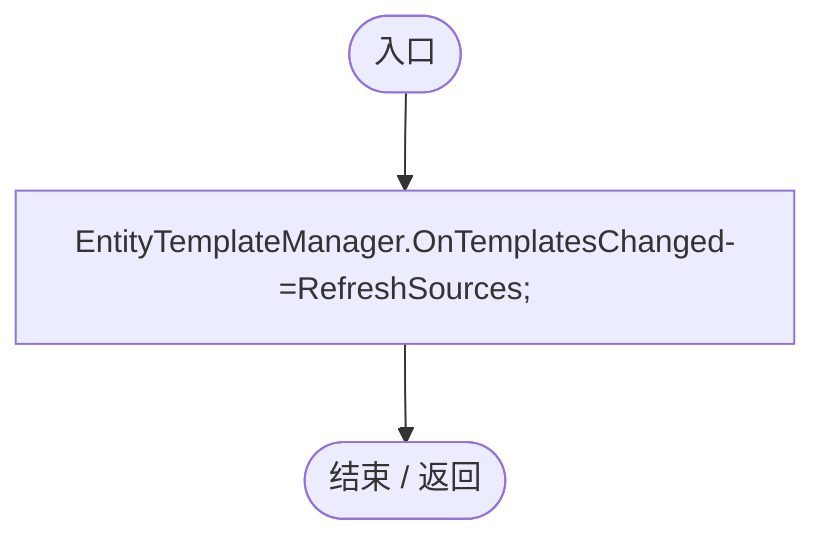

项目内调用/回调引用：

- [RandomSpawnPanel.RefreshSources · L48](ff6518313bce61e2.md#m47026ead3343f009)（方法）

## Build · L30

`private void Build()`

### Editor / Player · Roslyn编译器控制流

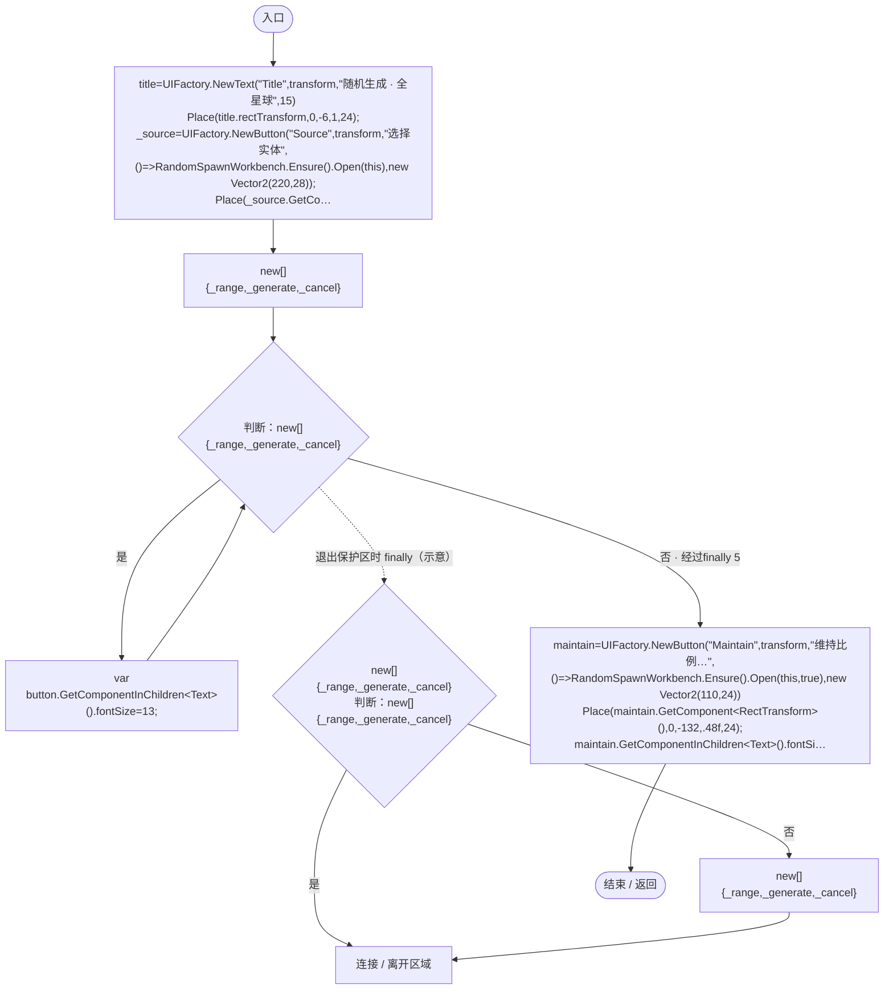

项目内调用/回调引用：

- [UIFactory.NewText · L57](dd1096a6995423db.md#m9dbccb5f0c38189e)（方法）
- [RandomSpawnPanel.Place · L46](ff6518313bce61e2.md#me02f3625c5fa0afe)（方法）
- [UIFactory.NewButton · L73](dd1096a6995423db.md#m5896f1b097c8bdde)（方法）
- [UIFactory.NewRect · L33](dd1096a6995423db.md#med612116f3152344)（方法）
- [UIFactory.Stretch · L150](dd1096a6995423db.md#m11d8f6c6d00cc047)（方法）
- [RandomSpawnPanel.回调@34 · L34](ff6518313bce61e2.md#mfa7765f97dc6f999)（回调/委托）
- [RandomSpawnPanel.回调@39 · L39](ff6518313bce61e2.md#m6bdcba78acf958d4)（回调/委托）
- [RandomSpawnPanel.回调@41 · L41](ff6518313bce61e2.md#mca9c7eaa03729bda)（回调/委托）
- [RandomSpawnPanel.回调@43 · L43](ff6518313bce61e2.md#md4e82c2703235dc0)（回调/委托）
- [RandomSpawnPanel.Generate · L55](ff6518313bce61e2.md#mc8efe088c970f158)（方法）

## 回调@34 · L34

`( … => 回调`

### Editor / Player · Roslyn编译器控制流

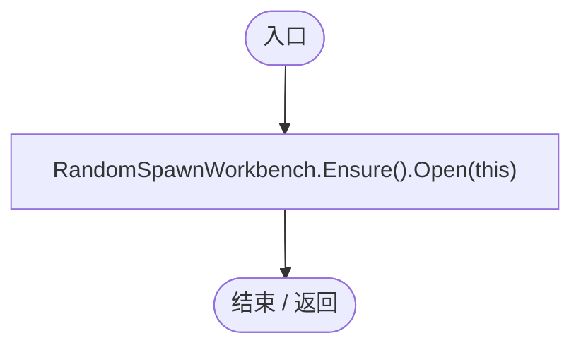

项目内调用/回调引用：

- [RandomSpawnWorkbench.Open · L29](0763b7475b3c75db.md#m0c118b57d249ff5d)（方法）
- [RandomSpawnWorkbench.Ensure · L27](0763b7475b3c75db.md#m52d26640eca61349)（方法）

## 回调@39 · L39

`( … => 回调`

### Editor / Player · Roslyn编译器控制流

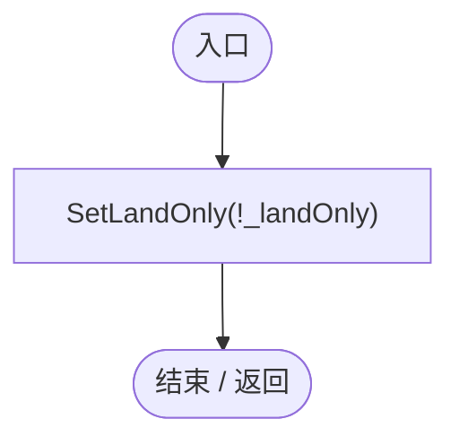

项目内调用/回调引用：

- [RandomSpawnPanel.SetLandOnly · L54](ff6518313bce61e2.md#mc961052fc1e13dc4)（方法）

## 回调@41 · L41

`( … => 回调`

### Editor / Player · Roslyn编译器控制流

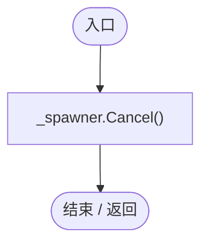

项目内调用/回调引用：

- [RandomPlanetSpawner.Cancel · L91](1c13222a547b265c.md#m13321aa05f521986)（方法）

## 回调@43 · L43

`( … => 回调`

### Editor / Player · Roslyn编译器控制流

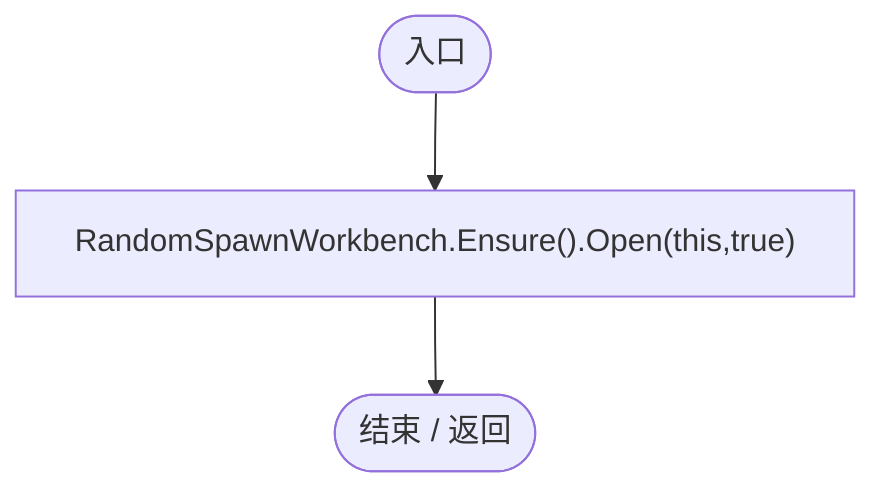

项目内调用/回调引用：

- [RandomSpawnWorkbench.Open · L29](0763b7475b3c75db.md#m0c118b57d249ff5d)（方法）
- [RandomSpawnWorkbench.Ensure · L27](0763b7475b3c75db.md#m52d26640eca61349)（方法）

## Place · L46

`private static void Place(RectTransform rt,float left,float top,float right,float height)`

### Editor / Player · Roslyn编译器控制流

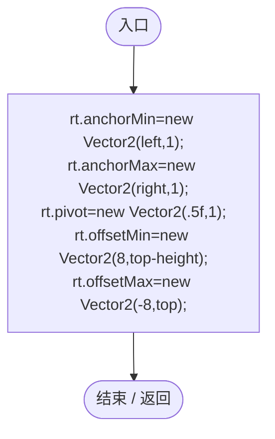

## RefreshSources · L48

`private void RefreshSources()`

### Editor / Player · Roslyn编译器控制流

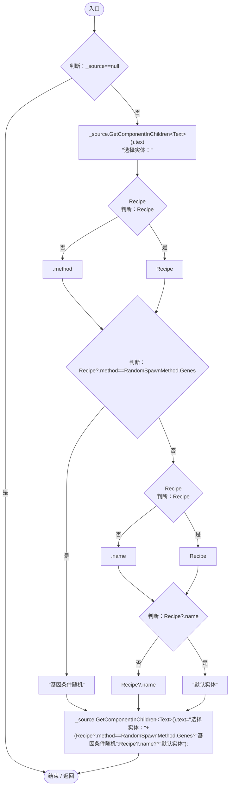

项目内调用/回调引用：

- [RandomSpawnPanel.Recipe.get · L19](ff6518313bce61e2.md#mb3265c1391d6ac92)（访问器）

## SetRecipe · L52

`public void SetRecipe(RandomSpawnRecipe recipe)`

### Editor / Player · Roslyn编译器控制流

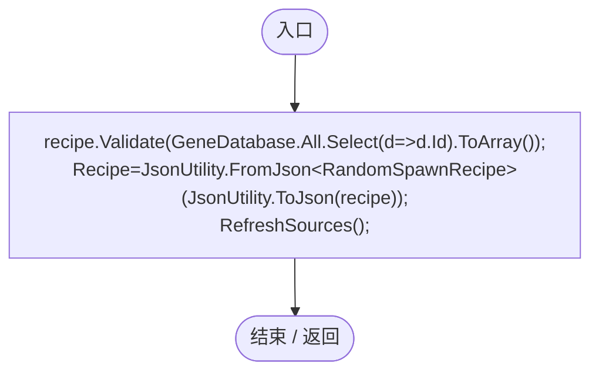

项目内调用/回调引用：

- [RandomSpawnRecipe.Validate · L48](923ccc4e86c4786c.md#m0fe74d9bb4825883)（方法）
- [GeneDatabase.All.get · L128](ec0a03483435a863.md#m0a367ed24734f426)（访问器）
- [RandomSpawnPanel.Recipe.set · L19](ff6518313bce61e2.md#m0a443248b065e69f)（访问器）
- [RandomSpawnPanel.RefreshSources · L48](ff6518313bce61e2.md#m47026ead3343f009)（方法）
- [RandomSpawnPanel.回调@52 · L52](ff6518313bce61e2.md#m59ca8977834b9c44)（回调/委托）

## 回调@52 · L52

`d … => 回调`

### Editor / Player · Roslyn编译器控制流

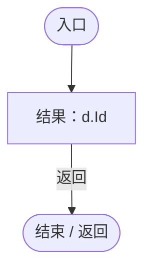

## SetLandOnly · L54

`public void SetLandOnly(bool value)`

★ 适配：来源窗口内的范围选择应用后同步到底栏，不能显示全部地表却仍按仅陆地生成。

### Editor / Player · Roslyn编译器控制流

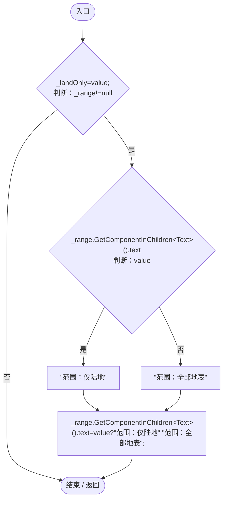

## Generate · L55

`public void Generate()`

### Editor / Player · Roslyn编译器控制流

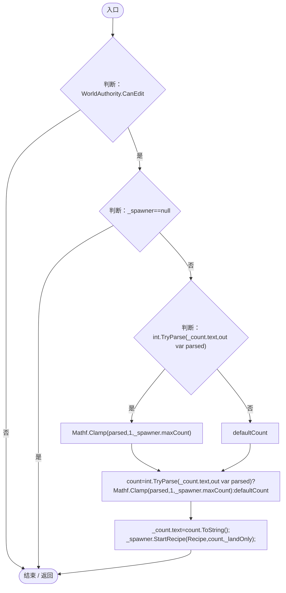

项目内调用/回调引用：

- [RandomPlanetSpawner.StartRecipe · L28](1c13222a547b265c.md#md37fb84c58dea354)（方法）
- [RandomSpawnPanel.Recipe.get · L19](ff6518313bce61e2.md#mb3265c1391d6ac92)（访问器）

## Update · L60

`private void Update()`

### Editor / Player · Roslyn编译器控制流

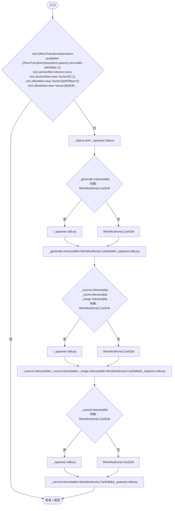

项目内调用/回调引用：

- [RandomPlanetSpawner.Status.get · L21](1c13222a547b265c.md#m5c54addf33fa43b9)（访问器）
- [RandomPlanetSpawner.IsBusy.get · L18](1c13222a547b265c.md#m93511175a525fd2b)（访问器）
